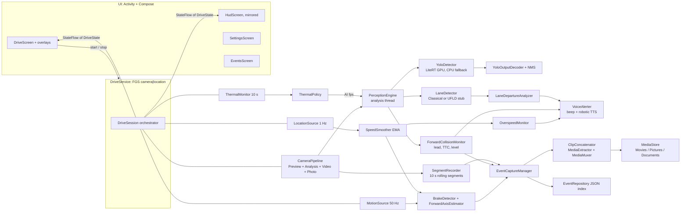

# DriveSentinel

A personal, on-device AI dashcam + ADAS assistant for Android (Kotlin, Jetpack Compose, CameraX, LiteRT).
It records a loop of the road, reads GPS speed, detects vehicles, pedestrians and lanes, and gives
audio-first alerts for **overspeed**, **forward collision**, **lane drift / lane change**, plus
**hard-brake event capture** (a ±10 s clip and 3 photos). There is also a mirrored **windshield HUD mode**.

> **Driver assistance only.** It is not a safety system: it may fail to warn, or warn falsely.
> Keep the phone mounted and do not interact with it while driving. See [Legal notes](#legal-notes-india).

---

## Contents
1. [Build and run](#build-and-run)
2. [Exporting a detector model](#exporting-a-detector-model) (+ [licence caveat](#licence-caveat))
3. [Architecture](#architecture)
4. [Feature details and thresholds](#feature-details-and-thresholds)
5. [Using HUD mode](#using-hud-mode)
6. [Known limitations (Indian roads)](#known-limitations-on-indian-roads)
7. [Legal notes (India)](#legal-notes-india)
8. [Design decisions](#design-decisions)
9. [Stubs and roadmap](#stubs-and-roadmap)

---

## Build and run

| Item | Version |
|---|---|
| AGP / Gradle | 8.7.3 / 8.11.1 (wrapper included) |
| Kotlin | 2.0.21 + Compose compiler plugin |
| compileSdk / targetSdk / minSdk | 35 / 35 / 26 |
| Compose BOM | 2024.12.01 |
| CameraX | 1.4.1 |
| play-services-location | 21.3.0 |
| LiteRT (TFLite runtime) | `com.google.ai.edge.litert:litert{,-gpu,-gpu-api}` 1.0.1 |

1. Open the folder in Android Studio (Ladybug or newer) and let it sync. Or run `./gradlew assembleDebug`.
   * The Gradle wrapper (`gradlew`, `gradle/wrapper/gradle-wrapper.jar`, `.properties`) is included.
     If your checkout lost the jar, run `gradle wrapper --gradle-version 8.11.1`, or just open the project in Android Studio.
2. Put a detector at `app/src/main/assets/yolo_detector.tflite` (see the next section). Without a model,
   the app still runs: it records, gives GPS speed alerts and hard-brake capture, and runs classical lane detection.
   The AI badge then shows "No model – lanes only".
3. Install, accept the first-run disclaimer, mount the phone **in landscape** with the rear camera facing the road,
   then tap **Start drive** (this grants camera, location and notification permissions).
4. Unit tests (pure Kotlin, no device needed): `./gradlew testDebugUnitTest`.
   They cover the TTC calculator and FCW evaluator, overspeed hysteresis, the brake detector and forward-axis learning,
   YOLO decoding (v8/11, transposed, YOLO26 end-to-end, YOLOX) and NMS, lane detection and departure states,
   the thermal ladder, and speed smoothing.

### Tested here vs. not tested
The 42 JVM unit tests were compiled and run with Kotlin 2.0.21 and JUnit 4 (they all pass). The Android-dependent
code (CameraX, LiteRT, Compose, services) was **not** compiled in this environment because no Android SDK was available.
It was written against the APIs of the versions above. See [Compile risks](#compile-risks).

---

## Exporting a detector model

The app expects **`app/src/main/assets/yolo_detector.tflite`** and **`coco_labels.txt`** (included: the 80 COCO classes, one per line).
The decoder detects the layout automatically from the output tensor shape:

| Model | Output tensor | Post-processing |
|---|---|---|
| YOLOv8 / YOLO11 (Ultralytics) | `[1, 84, 8400]` | Class-aware NMS in Kotlin |
| Transposed export | `[1, 8400, 84]` | NMS |
| YOLO26 / YOLOv10 (end-to-end) | `[1, 300, 6]` = x1, y1, x2, y2, score, class | None (NMS-free) |
| YOLOX (Apache-2.0) | `[1, N, 85]` = xywh, objectness, 80 scores | obj × cls, then NMS |

Input can be NHWC or NCHW, float32 (0..1) or uint8/int8 quantized. Frames are letterboxed with pad value 114.
Box coordinates can be normalized or in pixels; both are handled.

### Ultralytics (YOLO11n / YOLO26n)
```bash
pip install -U ultralytics

# YOLO11n, FP32 (runs as FP16 on the GPU delegate). Most portable choice.
yolo export model=yolo11n.pt format=tflite imgsz=640
#   -> yolo11n_saved_model/yolo11n_float32.tflite

# 2026 Ultralytics: `format=tflite` is deprecated in favour of `format=litert` with `quantize=`:
yolo export model=yolo26n.pt format=litert imgsz=640 quantize=32        # FP32
yolo export model=yolo26n.pt format=litert imgsz=640 quantize=w8a32     # dynamic INT8 weights, float activations
yolo export model=yolo26n.pt format=litert imgsz=640 quantize=8 data=coco8.yaml   # full INT8 (calibration needed)

cp <exported>.tflite app/src/main/assets/yolo_detector.tflite
```
* **Avoid `quantize=w8a16` on the GPU delegate.** Ultralytics measured it falling back to CPU at about 660 ms,
  against about 8–9 ms for FP32 or w8a32 on a Snapdragon 8 Elite Gen 5.
* YOLO26 is NMS-free (`[1,300,6]`). It removes the Kotlin NMS step, so latency is more predictable.
* A 16:9 input such as `imgsz=384,640` (h, w) cuts compute by about 40% on a landscape road view. The letterbox code supports rectangular inputs.
* Typical numbers: YOLO11n is about 2.6 M params and runs in about 2–14 ms end to end on recent Snapdragons.
  Mid-range phones probably take 20–40 ms on GPU (extrapolated, not measured).

### Apache-licensed alternative: YOLOX-nano
YOLOX (Megvii) is Apache-2.0. Export it to ONNX with decoding inside the graph, then convert to TFLite:
```bash
# in the YOLOX repo
python tools/export_onnx.py -n yolox-nano -c yolox_nano.pth --decode_in_inference -o 13
pip install onnx2tf && onnx2tf -i yolox_nano.onnx -o yolox_tflite   # produces *_float32.tflite
```
The output is `[1, N, 85]` in input-pixel units, which the decoder recognises as the `YOLOX` layout.
YOLOX expects **0..255** input with no normalization. If your conversion did not fold that in, change the
`/ 255f` in `YoloDetector.fillInput()`. Other permissive options: TF/KerasCV SSD or EfficientDet-Lite (Apache-2.0).
Those need a different output adapter (`TFLite_Detection_PostProcess`, 4 outputs).

### Licence caveat
**All Ultralytics models (YOLOv8, YOLO11, YOLO26), including their exported `.tflite` weights, are AGPL-3.0.**
This is fine for a private, personal build. If you **distribute** the APK (Play Store, sideload to others),
AGPL requires releasing the whole app's source under AGPL, or you need an Ultralytics Enterprise licence.
Fine-tuned derivatives inherit the same terms. That is why `*.tflite` is git-ignored. For a closed-source
distributable, use YOLOX (Apache-2.0) or another permissively licensed detector.

### Better accuracy in India (optional)
COCO has no **autorickshaw** class and confuses cattle and handcarts. Fine-tune YOLO11n/YOLO26n (or YOLOX-nano)
on **IDD** (IIIT-Hyderabad India Driving Dataset: about 46.6 K images; classes include autorickshaw, rider and animal)
and update `coco_labels.txt`, `RoadClasses.ALLOWED` / `LEAD_CANDIDATES` and the real-height priors to match.
IDD's licence terms are IIIT-H's own; check them.

### Lane model (optional, stub)
UFLD v2 (MIT) can be converted from the PINTO model zoo ONNX to `assets/ufld_v2.tflite`. The loader and
preprocessing exist (`UfldLaneDetector`), but row-anchor decoding is a TODO. Until it is done, the classical
detector is used. See [Stubs](#stubs-and-roadmap).

---

## Architecture

A single `:app` module, organised by package, with manual DI (`AppContainer`) and coroutines/Flow throughout.



ASCII summary of the per-frame path:
```
CameraX ImageAnalysis (RGBA, ~640x360, KEEP_ONLY_LATEST) -- throttled to 15/8/4/0 fps by ThermalPolicy
   |-> upright Bitmap --> YoloDetector (letterbox -> LiteRT -> decode/NMS) --> detections
   |-> 320x180 ARGB  --> ClassicalLaneDetector (ROI, Sobel, Hough vote, EMA) --> LaneEstimate
   '-> ForwardCollisionMonitor(detections, lanes, GPS speed) --> FcwStatus {NONE|WARNING|CRITICAL, TTC, distance}
       LaneDepartureAnalyzer(lanes, GPS speed) --> LaneStatus {CENTERED|LEFT/RIGHT_DRIFT|CHANGING_LEFT/RIGHT}
```

**Package map** (`com.drivesentinel.*`):

| Package | Contents | Pure Kotlin? |
|---|---|---|
| `core` | `BBox`, `Vec3`, `Ema` | yes |
| `perception.detector` | `YoloOutputDecoder`, `Nms`, `Letterbox`, `RoadClasses` / `YoloDetector` (LiteRT) | yes / no |
| `perception.lane` | `LaneDetector`, `ClassicalLaneDetector`, `LaneDepartureAnalyzer` / `UfldLaneDetector` | yes / no |
| `perception.fcw` | `LeadVehicleSelector`, `TtcCalculator`, `DistanceEstimator`, `FcwEvaluator`, `ForwardCollisionMonitor` | yes |
| `perception` | `PerceptionEngine` (CameraX analyzer) | no |
| `alerts` | `OverspeedMonitor`, `BeepSynth` / `VoiceAlerter` | yes / no |
| `sensors.location` | `SpeedSmoother` / `LocationSource` | yes / no |
| `sensors.motion` | `BrakeDetector`, `ForwardAxisEstimator` / `MotionSource` | yes / no |
| `thermal` | `ThermalPolicy` / `ThermalMonitor` | yes / no |
| `camera` | `CameraPipeline`, `SegmentRecorder` | no |
| `events` | `EventCaptureManager`, `ClipConcatenator`, `MediaStoreWriter` | no |
| `data.settings`, `data.events` | DataStore settings, `EventRepository` (JSON index) | no |
| `session` | `DriveSession`, `DriveState` | no |
| `service` | `DriveService` (FGS), notifications | no |
| `ui.*` | Compose screens, neon effects, HUD | no |

**Threading:**
* Main thread: camera binding, segment ring, event capture.
* One `ds-logic` thread: GPS, IMU and brake/overspeed logic, so there are no locks in the pure classes.
* One `ds-analysis` thread: perception. The GPU delegate is thread-affine and is created, used and closed there.
* The UI only observes `StateFlow<DriveState>`.

---

## Feature details and thresholds

| Feature | Behaviour | Where |
|---|---|---|
| Camera | Preview + ImageAnalysis (RGBA, KEEP_ONLY_LATEST, about 640×360) + VideoCapture (Recorder, HD) + ImageCapture are bound in **one** `bindToLifecycle`. If the device rejects the combination, the fallback order is: no ImageCapture (photos come from AI frames), then SD video, then analysis only. The active mode shows as a badge. | `CameraPipeline` |
| GPS speed | Fused 1 Hz `PRIORITY_HIGH_ACCURACY`, no batching. Doppler `speed` gated by `speedAccuracy` (≤ 2 m/s). Accuracy-weighted EMA, standstill clamp below 0.8 m/s, stale after 2.5 s ("GPS weak"). | `SpeedSmoother`, `LocationSource` |
| Overspeed | Above the threshold (default **80 km/h**) for 2 consecutive reliable fixes, then a beep plus robotic "Slow down". Clears at **threshold − 5**. Repeats every **10 s**. Pulsing neon red side bars. | `OverspeedMonitor` |
| Voice | `AudioTrack` synthesized robotic beep, then TTS with pitch 0.6 and rate 1.15, preferring an offline en-IN voice. `USAGE_ASSISTANCE_NAVIGATION_GUIDANCE` with transient-may-duck focus. Urgent alerts pre-empt. | `VoiceAlerter`, `BeepSynth` |
| AI detection | YOLO via LiteRT with the GPU delegate (compat list) and CPU/XNNPACK fallback. Filtered to person, bicycle, car, motorcycle, bus, truck, dog and cow. Boxes, labels, distance and TTC are drawn on an overlay. | `YoloDetector`, `PerceptionOverlay` |
| Lanes | Pure-Kotlin classical: trapezoid ROI, Sobel with an adaptive percentile threshold, a 2-D Hough-style vote over (x_bottom, x_top) lines, slope gating, EMA, outlier gating and an 8-frame hold. Pluggable `LaneDetector`. | `ClassicalLaneDetector` |
| Lane state | Offset d = (x_cam − centre)/width, using a calibrated mount offset ("Centre lane" button). **Drift**: \|d\| ≥ 0.30 for ≥ 0.5 s while moving slowly. **Change**: fast outward motion (≥ 0.45 lane/s) or a line-crossing sign flip, held 2 s. Suppressed **below 40 km/h** or at low confidence. | `LaneDepartureAnalyzer` |
| FCW | Lead = largest candidate box with its bottom centre in the ego corridor (lanes if confident, otherwise a perspective trapezoid). TTC = T/(s−1) with T 0.5–1.0 s back, median-of-3 heights and EMA on 1/TTC. Distance = f·H_real/h. **WARNING < 2.7 s** (amber, beep). **CRITICAL < 1.5 s** ("Brake! Brake!", red flash, event capture). Only **above 15 km/h**, after 3 or 2 confirming frames, with release hysteresis. Sensitivity scales the thresholds by 0.8, 1.0 or 1.2. | `perception.fcw` |
| Hard brake | Linear acceleration minus the vertical component, low-passed at about 4 Hz. Projected on the **learned forward axis** (correlating horizontal acceleration with GPS speed change), or the magnitude fallback. Requires **≥ 0.4 g for ≥ 300 ms** AND a **GPS drop ≥ 10 km/h within 2.5 s** from ≥ 15 km/h. Accelerometer-only is an option. Vertical-dominant (pothole) spikes are rejected. **20 s cooldown**. | `BrakeDetector` |
| Event capture | Rolling **10 s segments** in `cacheDir/segments`; the last 3 are kept, plus any locked by an event. On an event: 3-photo burst, then wait for the 10 s post-roll, rotate the segment, remux and trim to **−10 s…+10 s** (lossless MediaExtractor/MediaMuxer), then publish to `Movies/DriveSentinel` and `Pictures/DriveSentinel`, with a JSON sidecar in `Documents/DriveSentinel` and a private index. | `SegmentRecorder`, `EventCaptureManager`, `ClipConcatenator` |
| Thermal | `getThermalHeadroom(10)` every 10 s plus the status listener. AI fps steps down **15 → 8 → 4 → paused (SEVERE)**. At CRITICAL, loop recording also pauses. Recovery steps down one level per 30 s. A badge is shown. | `ThermalPolicy`, `ThermalMonitor` |
| Settings | DataStore: speed threshold, voice, HUD mirror, lane assist, FCW on and sensitivity, brake sensitivity and accel-only, quota (auto-deletes the oldest events), mount offset, overlay boxes. **Locked above 5 km/h.** | `SettingsRepository`, `SettingsScreen` |

---

## Using HUD mode

1. Start a drive, then tap **HUD**.
   * The screen turns pure black, with no camera preview: black OLED pixels reflect as transparent.
   * It shows huge speed digits, a speed-limit ring, an FCW indicator, neon side bars and lane-change guidance.
2. The content is mirrored with `graphicsLayer(scaleX = -1f)` so it reads correctly in the windshield.
   Turn mirroring off in Settings if you look at the phone directly.
3. Brightness is forced to maximum, the system bars are hidden and the screen stays on while the HUD is shown.
   **Double-tap** to exit. Do this only when stopped.
4. Lane guidance:
   * When the lane state is `CHANGING_LEFT/RIGHT`, animated chevrons and "Lane change LEFT/RIGHT" appear.
   * If an FCW warning is active during a change, a red **HOLD LANE** appears instead.
   * Slow drifts show "DRIFTING LEFT/RIGHT" with an amber edge glow.
5. Practicalities:
   * Lay the phone flat under the windshield in a dark car. A bare windshield produces a double image; a HUD reflector film fixes it.
   * Daylight legibility is poor.
   * Phones lying flat in the sun overheat; watch the thermal badge.

---

## Known limitations on Indian roads

* **Lane markings** are often faded or absent. The classical detector only works on painted highways or ORR-type roads.
  Elsewhere it reports "Lanes: not found" and stays silent, by design. A drivable-area segmentation model
  (for example TwinLiteNet fine-tuned on IDD) is the real fix.
* **Mixed traffic and cut-ins.** Two-wheelers and autos cut in close. FCW therefore needs confirmation frames and
  resets TTC when the lead target changes, which delays warnings by about 0.2–0.3 s.
  * COCO has **no autorickshaw** class; autos are often detected as car or motorcycle, with the wrong height prior.
  * Cattle and handcarts are inconsistently detected.
* **Monocular distance** uses class-average heights; ±30% error is normal. TTC (scale-based) does not depend on it.
* **Stop-and-go**: FCW is suppressed below 15 km/h and lane alerts below 40 km/h to avoid nuisance alarms.
  Indian ADAS owners report disabling over-eager systems.
* **Speed limits**: 80 km/h is the default only because it was specified. Under MoRTH S.O. 1522(E) (2018),
  the limits for **M1 cars are 120 (expressway), 100 (4-lane divided) and 70 (municipal/other)**. Cities set lower limits
  (Bengaluru is about 60). Set the threshold to your road.
* **Speed breakers and potholes** cause large vertical spikes. These are rejected, but a hard brake *for* a speed breaker
  is a real hard brake and will be recorded.
* **Night high beams, monsoon rain, wipers** and windshield glare all degrade detection. There is no
  "ADAS limited" auto-detection yet.
* **Heat**: a dashboard in an Indian summer will throttle any phone. Use a vent mount, avoid direct sun and
  don't fast-charge while recording.
* GPS drops under flyovers and in tunnels: the speed is marked unreliable and overspeed alerts pause.

---

## Legal notes (India)

* **MV Act s.184 (as amended 2019).** Using a handheld communication device while driving counts as dangerous driving.
  The 2020 amendment to the Driving Regulations allows phone use **only for route navigation, with the device fixed on
  the dashboard, in a manner that does not disturb the driver's concentration**.
  * Use DriveSentinel only **mounted**, as a glance-free, navigation-style aid.
  * Don't touch it while moving. Settings lock above 5 km/h.
  * Whether an ADAS or dashcam app counts as "navigation" is legally untested.
* **DPDP Act 2023 s.3(c)** exempts personal data processed by an individual for a **personal or domestic purpose**.
  * Footage stays **local on the device**: no upload, no cloud, no sharing features.
  * Sharing or publishing footage (faces, number plates) likely takes you outside that exemption. Blur before sharing.
* Dashcam footage as evidence now falls under s.63 of the Bharatiya Sakshya Adhiniyam 2023, which needs a certificate. Verify with counsel.
* This is not legal advice.

---

## Design decisions

* **Inference runtime choice: LiteRT Interpreter API, not `CompiledModel`.**
  * LiteRT 2.x `CompiledModel` (`com.google.ai.edge.litert:litert:2.x`) is Google's recommended 2026 API.
  * Its Kotlin surface changed across 2.0–2.3 and could not be compile-verified offline here, so the default backend is the
    stable `org.tensorflow.lite.Interpreter` + `GpuDelegate` (from the `com.google.ai.edge.litert` 1.x artifacts:
    same packages as TFLite, the renamed runtime).
  * NNAPI is not used; it is deprecated since Android 15.
  * A drop-in `CompiledModel` backend sketch is in `extras/CompiledModelDetector.kt.txt`.
* **Foreground service type `camera|location`, no `microphone`.**
  * DriveSentinel records **no audio**. This is better for privacy (other occupants), needs one fewer while-in-use
    permission and makes Play review simpler.
  * Declared: `FOREGROUND_SERVICE`, `FOREGROUND_SERVICE_CAMERA`, `FOREGROUND_SERVICE_LOCATION`.
  * The service is started only from the visible activity (Start drive), never from boot or background, as required
    for camera/location FGS on Android 14/15.
  * `startForeground` passes only the types whose permission is granted.
  * No `ACCESS_BACKGROUND_LOCATION`.
  * The camera is bound to the **service's** lifecycle (`LifecycleService`), so recording, AI and alerts continue when
    the app is backgrounded. The activity only attaches the preview surface.
  * Audio focus works on Android 15 because the FGS is running.
* **Pre-event buffer via rolling Recorder segments, not a MediaCodec ring.** This is simple and robust with CameraX.
  The cost is a small stop/start gap between segments (typically a few hundred ms).
  A gapless alternative is the Grafika `CircularEncoder` pattern (MediaCodec + an encoded ring + MediaMuxer).
* **Pure-Kotlin core.** All decision logic (decoding, NMS, TTC, FCW, lanes, overspeed, brake, thermal, speed) is free of
  Android types, so it is unit-tested on the JVM and deterministic (time is injected).
* **Alerts are audio-first**, with simple colour cues and flashes below 3 Hz. The driver never has to read text.

### Compile risks
These parts were written carefully but not compiled here (no Android SDK offline):
* `litert` / `litert-gpu` / `litert-gpu-api` **1.0.1** coordinates. If resolution fails, bump to the latest 1.x, or swap to
  `org.tensorflow:tensorflow-lite{,-gpu,-gpu-api}:2.16.1` with no code change (same packages).
  For 16 KB page-size devices, prefer the newest LiteRT 1.x.
* `CompatibilityList().bestOptionsForThisDevice` returning the type the `GpuDelegate(...)` constructor expects
  (true for TFLite 2.1x and LiteRT 1.x).
* CameraX 1.4: `VideoCapture.Builder(recorder)`, `ResolutionStrategy(Size, rule)`, `Camera2CameraInfo.getCameraCharacteristic`
  (opt-in `ExperimentalCamera2Interop`), and `ImageProxy.toBitmap()` on RGBA.
* `MediaStore.Files` insert of `application/json` under `Documents/DriveSentinel` (API 29+). If a device rejects it,
  the sidecar still lives in the private index (`files/events/<id>.json`).

---

## Stubs and roadmap

* **UFLD v2 lane model**: loading and inference exist, but row-anchor decoding is `TODO(ufld-decode)` in
  `UfldLaneDetector`. `isAvailable = false` keeps the classical detector active.
* No object tracker beyond an IoU lead-track id. A ByteTrack/SORT tracker would stabilise FCW further.
* No blind-spot approximation (impossible to do properly with one forward camera) and no turn-signal input.
* No "ADAS limited" auto-detection for night, rain or glare. No automatic speed-limit (sign) reading.
* Camera intrinsics come from Camera2 (`LENS_INFO_AVAILABLE_FOCAL_LENGTHS` / `SENSOR_INFO_PHYSICAL_SIZE`), assuming the
  16:9 crop keeps the full sensor width. Otherwise a 70° HFOV is assumed. There is no checkerboard calibration.
* `PerformanceHintManager` (ADPF) is not wired.
